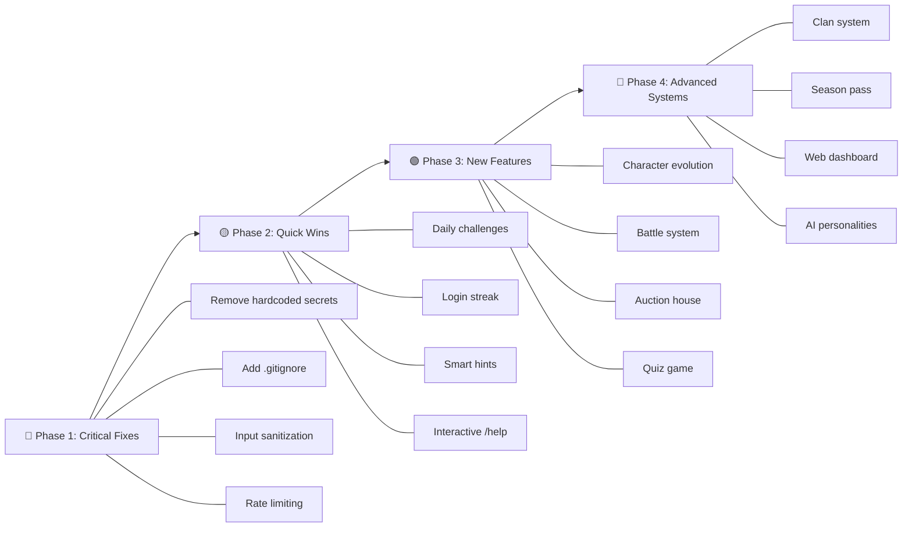

# 🌸 Aoi Waifu Bot — Master Ideas & Enhancement Plan

> **Repo:** `C:\map\1\aoiwaifu-main`
> **Date:** 30 Oct 2026
> **Total Ideas:** 75+

---

## 📑 Table of Contents

1. [🎮 New Games & Mini-Apps](#-new-games--mini-apps)
2. [🌸 Character System Enhancements](#-character-system-enhancements)
3. [💰 Economy & Currency System](#-economy--currency-system)
4. [👗 Dress-Up System Upgrades](#-dress-up-system-upgrades)
5. [🏆 Leaderboard & Competition Ideas](#-leaderboard--competition-ideas)
6. [🤖 AI & Smart Features](#-ai--smart-features)
7. [🎲 Gambling & Casino Improvements](#-gambling--casino-improvements)
8. [📱 UI/UX & Bot Experience](#-uiux--bot-experience)
9. [🔄 Trading & Social Features](#-trading--social-features)
10. [📅 Events & Seasonal Content](#-events--seasonal-content)
11. [🛡️ Security & Code Quality Fixes](#️-security--code-quality-fixes)
12. [⚡ Performance & Architecture](#-performance--architecture)
13. [📊 Analytics & Admin Tools](#-analytics--admin-tools)
14. [🌐 Web Dashboard & Mini-App Ideas](#-web-dashboard--mini-app-ideas)

---

## 🎮 New Games & Mini-Apps

### 1. 🧩 Anime Quiz Game (`/quiz`)
**What:** Anime trivia quiz with multiple choice questions — "Which anime is this character from?", "Name the attack move", etc.
**How:** Create `modules/quiz.py`. Store quiz questions in a `quiz_questions` MongoDB collection. Show character image + 4 options via `InlineKeyboardButton`. Award coins for correct answers.
**Benefit:** Increases engagement without requiring character catching.

### 2. 🃏 Anime Card Battle System (`/battle`)
**What:** Turn-based PvP card battles using collected characters. Each character has ATK/DEF/SPD stats based on rarity.
**How:** New `modules/battle.py`. Stats formula: `ATK = rarity_tier * 10 + random(1,5)`. Players pick 3 characters from harem → compare stats → winner gets coins from loser.
**Benefit:** Gives purpose to collecting rare characters beyond display.

### 3. 🎯 Character Auction House (`/auction`)
**What:** Players list characters for auction. Others bid with coins. Highest bid wins after timer expires.
**How:** New `modules/auction.py` + `auctions` MongoDB collection. Use APScheduler to auto-close auctions after 24h. Broadcast to interested groups.
**Benefit:** Creates a real marketplace economy.

### 4. 🏰 Clan/Guild System (`/clan`)
**What:** Create clans with other players. Clan leaderboards, clan wars, clan-exclusive characters.
**How:** New `modules/clan.py` + `clans` collection. Max 50 members. Clan XP from member catches. Weekly clan rankings.
**Benefit:** Community building and group retention.

### 5. 🎪 Memory Match Game (`/memory`)
**What:** Telegram WebApp-based memory card matching game using anime character images.
**How:** New HTML5 game in `games/memory-match/`. Show 12 cards face down → flip 2 at a time → match pairs → score based on speed.
**Benefit:** New casual game that leverages existing character images.

### 6. 🏃 Character Race (`/race`)
**What:** Pick a character from harem → race against other players' characters → winner determined by rarity + random factor.
**How:** New `modules/race.py`. 3-5 players join with `/race join`. Auto-start after 30s. Animated text updates showing race progress.
**Benefit:** Group activity that doesn't require skill, just luck and collection.

### 7. 🎵 Anime Song Guess (`/songguess`)
**What:** Play an anime opening/ending audio clip → players guess the anime name.
**How:** Store audio clips as Telegram voice messages. New `modules/songguess.py`. Send audio → first correct guess wins.
**Benefit:** Different type of guessing game for variety.

### 8. 📸 Waifu Photo Contest (`/contest`)
**What:** Weekly photo contest where users submit their best character image → community votes → winner gets rare character.
**How:** New `modules/contest.py`. Users submit via inline buttons → voting period → announcement.
**Benefit:** User-generated content and community engagement.

---

## 🌸 Character System Enhancements

### 9. ⭐ Character Evolution/Upgrade System
**What:** Merge duplicate characters to upgrade rarity. 3x Frequent → 1x Superior, 3x Superior → 1x Elite, etc.
**How:** New `/evolve <char_id>` command in `modules/evolve.py`. Check user has 3+ duplicates → remove 3 → give 1 higher rarity.
**Benefit:** Makes duplicate characters valuable instead of useless.

### 10. 💎 Character Skins/Alternate Art
**What:** Some characters have alternate art versions (seasonal, battle, casual). Unlockable via coins or events.
**How:** Add `alt_images: [{img_url, skin_name, unlock_cost}]` field to character documents. New `/skin <char_id>` command.
**Benefit:** Collectible depth, more items to chase.

### 11. 🏷️ Character Nickname System (`/nick`)
**What:** Set a custom nickname for any character in your harem.
**How:** Add `nickname` field to character entries in user's `characters` array. Show nickname in harem view.
**Benefit:** Personal customization.

### 12. ❤️ Character Affection/Loyalty System
**What:** Characters gain affection points the longer they're in your harem. High affection = bonus coins from /daily.
**How:** Track `acquired_at` timestamp per character. `affection = days_owned * 10`. Bonus: `daily_coins += top_affection_char / 100`.
**Benefit:** Rewards long-term retention, discourages trading away characters.

### 13. 🎖️ Character Badge/Achievement System
**What:** Earn badges for collecting milestones: "Anime Master" (collect all chars from 1 anime), "Rarity Hunter" (1 of each rarity), "Speed Demon" (catch in <5 seconds).
**How:** New `modules/achievements.py` + `achievements` collection. Check conditions on each catch.
**Benefit:** Long-term goals and bragging rights.

### 14. 🔮 Mystery Character Spawns
**What:** Occasionally spawn a "???" character with silhouetted/blurred image. Only the name is needed to catch. If caught, revealed as ultra-rare.
**How:** In `aoi_send_img.py`, 5% chance to spawn with blurred image (Pillow GaussianBlur). Set rarity_override to Mythical+.
**Benefit:** Exciting surprise events in groups.

### 15. 📊 Character Power Level System
**What:** Every character has a power level based on rarity + anime popularity. Show in harem and profile.
**How:** `power_level = rarity_weight * 100 + random_seed`. Display in `/check <id>` and `/harem`.
**Benefit:** Adds numerical comparison value to characters.

### 16. 🌟 Shiny/Holographic Characters
**What:** 1% chance a spawned character is "Shiny" variant — same character but marked as ✨ Shiny with special border.
**How:** Add `is_shiny: True` flag when spawning. In `send_image()`, 1% roll → add ✨ to name + golden border overlay with Pillow.
**Benefit:** Ultra-rare collecting mechanic like Pokémon shinies.

### 17. 📖 Character Lore/Bio System
**What:** Each character has a short bio/description viewable via `/bio <id>`.
**How:** Add `bio` field to character documents. Admin command `/setbio <id> <text>`. Display in `/check`.
**Benefit:** Educational anime content within the bot.

### 18. 🎭 Character Mood/Expression System
**What:** Characters have moods that change randomly — Happy, Sad, Angry, Sleepy. Affects daily bonus.
**How:** Random mood assigned to user's fav character daily. Happy = +20% coins, Sad = -10% coins from /daily.
**Benefit:** Dynamic feel, daily surprise element.

---

## 💰 Economy & Currency System

### 19. 🏦 Banking System (`/bank`)
**What:** Deposit coins in bank for interest. 2% daily interest on deposited amount (max 50k/day).
**How:** New `modules/bank.py`. Fields: `bank_balance`, `last_interest_date`. `/bank deposit <amount>`, `/bank withdraw <amount>`.
**Benefit:** Coin sink + passive income for active players.

### 20. 📈 Stock Market for Characters (`/market`)
**What:** Characters have "stock prices" that fluctuate daily based on catch frequency. Buy/sell character stocks.
**How:** Track daily catch counts per character. Price formula: `base_price * (1 + daily_catches / avg_catches)`. Store in `character_stocks` collection.
**Benefit:** Advanced economy feature for competitive players.

### 21. 💳 Premium Currency — Gems
**What:** Third currency alongside Coins and Dollars. Earned from achievements, referrals, events. Used for exclusive items.
**How:** Add `gems` field to user document. Gems for: 7-day login streak (10 gems), first catch of day (2 gems), achievement completion.
**Benefit:** Premium feel without real money.

### 22. 🎫 Lottery/Raffle System (`/lottery`)
**What:** Daily lottery pool. Users buy tickets (500 coins each). Random winner gets the entire pool at midnight IST.
**How:** New `modules/lottery.py` + `lottery_pool` collection. APScheduler at midnight IST → pick random ticket → award pool.
**Benefit:** Exciting daily event, coin sink.

### 23. 💸 Tax System on Trades
**What:** 5% tax on trades and pay transactions above 10k coins. Tax goes into a community pool used for weekly giveaways.
**How:** Modify `trade.py` and `balance.py` `/pay` to deduct 5% to `community_pool` field in a system document.
**Benefit:** Inflation control, community rewards.

### 24. 🎁 Gift Box System (`/giftbox`)
**What:** Random loot box purchasable for coins. Contains random character, coins, or rare items.
**How:** `modules/giftbox.py`. Tiers: Bronze (1k coins), Silver (5k), Gold (20k). Random rewards with weighted drops.
**Benefit:** Gacha-style excitement.

### 25. 💵 Monthly Bonus System
**What:** First day of each month, all players get a special "Monthly Login" bonus of 5000 coins + 1 random character.
**How:** Check `last_monthly` date in user doc. Reset on 1st of month.
**Benefit:** Monthly retention incentive.

---

## 👗 Dress-Up System Upgrades

### 26. 🆕 New Dress-Up Characters
**What:** Add more characters: Naruto, Luffy, Mikasa, Zero Two, Rem, Tanjiro, etc.
**How:** Create new sprite sheets in `web/dress-up/characters/`. Follow existing pattern: `<name>.js` + `<name>_sprites.js` + `<name>_dresses.js`.
**Benefit:** More variety, longer engagement.

### 27. 🏠 Dorm/Room Decoration
**What:** Virtual room that users can decorate with earned furniture items. Background for profile cards.
**How:** New `dorm_items` collection. Items: beds, desks, posters, lamps. Pixel art rendered with Pillow on profile card.
**Benefit:** Another collectible dimension.

### 28. 🎨 Custom Color Palette for Dress-Up
**What:** Let users pick custom colors for hair, eyes, and accessories using a color picker.
**How:** Add color picker in WebApp `engine.js`. Send hex color to backend → apply tint to sprites using canvas `globalCompositeOperation`.
**Benefit:** Unique personalization.

### 29. 💍 Accessories System
**What:** Rings, necklaces, watches, headbands — small accessories that layer on top of dress-up outfits.
**How:** New sprite layer "accessories" rendered above dress layer. Items earned from events/shop.
**Benefit:** More customization depth.

### 30. 📸 Photo Mode for Dress-Up
**What:** Let users take high-res screenshots of their dress-up character with custom backgrounds, poses, and filters.
**How:** Add "📸 Photo Mode" button in WebApp → apply post-processing filters (sepia, vignette, bokeh) via canvas → download/share.
**Benefit:** Shareable content that promotes the bot.

### 31. 👥 Couple Dress-Up
**What:** Two users combine their dress-up characters into a "couple photo" with matching outfits.
**How:** Render both users' characters side-by-side with `render_couple_card()` function. Matching outfit bonus coins.
**Benefit:** Social feature, viral sharing.

---

## 🏆 Leaderboard & Competition Ideas

### 32. 🏅 Season Pass / Battle Pass
**What:** Monthly season with 30 tiers. Complete daily/weekly missions to earn XP → unlock rewards at each tier.
**How:** `modules/season.py` + `season_progress` collection. Missions: catch 5 chars, play 3 games, trade 1 char. Each mission = XP. Tiers unlock coins/characters/dress-up items.
**Benefit:** Structured progression system.

### 33. 🏟️ Weekly Tournament
**What:** Saturday-Sunday tournaments. Most catches, highest gambling winnings, most games played → prizes.
**How:** `modules/tournament.py`. Track stats per weekend. Auto-announce winners on Monday.
**Benefit:** Competitive drive, scheduled events.

### 34. 📊 Detailed Stats Dashboard (`/mystats`)
**What:** Comprehensive personal statistics: total catches, catch rate, fastest catch, gambling P&L, games played, streaks.
**How:** Track all events in a `user_stats` collection. Aggregate and display.
**Benefit:** Data lovers love stats.

### 35. 🎯 Daily Challenges
**What:** 3 daily challenges that reset at midnight IST: "Catch 3 characters", "Win a blackjack hand", "Send 50 messages".
**How:** `modules/challenges.py`. Daily challenge pool → track progress → reward on completion (500 coins each).
**Benefit:** Daily active user retention.

### 36. 🏆 Group Ranking Tiers
**What:** Groups earn tiers based on total catches: Bronze, Silver, Gold, Diamond, Master. Higher tiers = faster spawns.
**How:** In `massage.py`, reduce message threshold based on group tier. E.g., Master tier = 50 messages instead of 80.
**Benefit:** Incentivizes group activity.

---

## 🤖 AI & Smart Features

### 37. 🧠 AI Waifu Chat Personality Modes
**What:** Multiple AI personality modes: Tsundere, Yandere, Kuudere, Dandere. User picks with `/aimode`.
**How:** Change system prompt based on selected mode in `modules/ai.py`. Store preference in user doc.
**Benefit:** Fun, personalized AI interactions.

### 38. 🎨 AI Character Art Generation
**What:** Generate custom anime character art using AI. `/generate <description>` → AI creates anime image.
**How:** Integrate with an image generation API (Stability AI, DALL-E). Store generated images for sharing.
**Benefit:** Unique content creation.

### 39. 📝 AI Anime Recommendations
**What:** `/recommend` → AI analyzes user's collected characters → suggests anime they might like.
**How:** In `ai.py`, fetch user's anime list from harem → send to AI with prompt "Based on these anime, recommend 5 new ones".
**Benefit:** Value-add for anime fans.

### 40. 🔍 Smart Character Hint System
**What:** After 60 seconds of no correct guess, bot gives a hint: first letter, anime name, or rarity.
**How:** In `send_image()`, schedule hint task after 60s. Hints: "First letter: N", "From: Naruto", "Rarity: Elite".
**Benefit:** Reduces frustration, helps new players.

### 41. 🗣️ AI-Powered Character Dialogue
**What:** `/talk <char_id>` — Talk to any character in your harem. AI responds as that character.
**How:** System prompt: "You are [character_name] from [anime]. Respond in character." Use character bio for context.
**Benefit:** Immersive fan experience.

---

## 🎲 Gambling & Casino Improvements

### 42. 🎰 Poker Game (`/poker`)
**What:** Texas Hold'em poker with 2-6 players. Bet coins, play full poker hands.
**How:** New `modules/poker.py`. Use python `treys` library for hand evaluation. Store game state in MongoDB.
**Benefit:** Major casino game addition.

### 43. 🎲 Dice Duel (`/dice`)
**What:** Simple dice roll game. Higher roll wins. Can bet coins.
**How:** New `modules/dice.py`. Both players roll 2 dice → highest total wins. Uses Telegram dice animation.
**Benefit:** Quick, simple gambling game.

### 44. 🃏 War Card Game (`/war`)
**What:** Classic War card game. Each player draws a card → higher card wins the round → best of 5.
**How:** New `modules/war.py`. Standard 52-card deck logic. Bet coins on outcome.
**Benefit:** Easy to understand, quick rounds.

### 45. 📈 Crash Game (`/crash`)
**What:** Multiplier starts at 1.0x and increases. Cash out before it "crashes" (random point). Greedy players lose all.
**How:** New `modules/crash.py`. Animated multiplier updates via message edits. Crash point: `1 / random(0,1)` distribution.
**Benefit:** High-adrenaline gambling game.

### 46. 🎡 Improved Wheel with Visual Animation
**What:** Current wheel shows text animation. Upgrade to WebApp-based visual spinning wheel.
**How:** New HTML5 wheel in `games/lucky-wheel/`. Canvas-based animated wheel with sectors. Score submission via API.
**Benefit:** Much better visual experience.

### 47. 🏇 Horse Racing (`/horserace`)
**What:** Pick a horse (1-5) → animated race text → winner gets bet × odds.
**How:** `modules/horserace.py`. Each horse has random odds (1.5x to 10x). Animated race with emojis: 🏇————————🏁
**Benefit:** Group activity gambling game.

### 48. 💰 Gambling Stats & History
**What:** `/gamblestats` shows your total wins, losses, biggest win, biggest loss, and profit/loss ratio.
**How:** Track all gambling outcomes in `gambling_history` collection. Aggregate per user.
**Benefit:** Responsible gambling awareness + competitive stats.

---

## 📱 UI/UX & Bot Experience

### 49. 🌙 Dark/Light Mode for WebApps
**What:** Add theme toggle to dress-up and game WebApps.
**How:** CSS custom properties + `data-theme` attribute toggle. Save preference in `localStorage`.
**Benefit:** Better user comfort.

### 50. 📋 Interactive Help Menu (`/help`)
**What:** Replace static help text with paginated interactive menu with category buttons.
**How:** `InlineKeyboardMarkup` with categories: 🎮 Games, 💰 Economy, 🌸 Collection, 👗 Dress-Up, etc. Each shows sub-commands.
**Benefit:** Easier command discovery.

### 51. 🔔 Notification Preferences (`/notify`)
**What:** Let users toggle notifications: trade offers, referral rewards, daily reminders, spawn alerts.
**How:** `notification_prefs` field in user doc. Check before sending DMs.
**Benefit:** Reduces spam, happier users.

### 52. 🌍 Multi-Language Support
**What:** Support Hindi, Spanish, Portuguese, Indonesian, Arabic translations of bot messages.
**How:** `i18n/` directory with JSON language files. User sets language via `/lang`. Load strings from language file.
**Benefit:** Global user base expansion.

### 53. 🎨 Custom Profile Themes
**What:** Users pick profile card themes: Sakura, Dark Night, Ocean, Forest, Neon.
**How:** Different background templates for `render_dressup_character_card()`. Select via `/theme`.
**Benefit:** Personalization.

### 54. 📱 Telegram Mini App Hub
**What:** Unified Mini App with tabs: Harem Gallery, Dress-Up, Games, Shop, Profile — all in one WebApp.
**How:** Single-page app in `web/hub/`. Tabs using vanilla JS routing. API calls to existing endpoints.
**Benefit:** Modern app-like experience within Telegram.

---

## 🔄 Trading & Social Features

### 55. 🤝 Trade Market Board
**What:** A bulletin board where users post "Want: Character X, Offer: Character Y" listings.
**How:** `modules/tradeboard.py` + `trade_listings` collection. `/list <want_id> <offer_id>` → others browse → `/accept <listing_id>`.
**Benefit:** Easier trading without finding partners.

### 56. 💌 Waifu Marriage System (`/marry`)
**What:** "Marry" your favorite character. Get daily bonus, special title, couple profile card.
**How:** `modules/marry.py`. One marriage at a time. `/marry <char_id>` sets `married_to` field. +50 daily coins bonus.
**Benefit:** Emotional attachment to characters.

### 57. 🎁 Gifting System Upgrade
**What:** Gift coins, dress-up items, or energy to friends. Not just characters.
**How:** Extend `gift.py` to support `/gift coins <amount> @user`, `/gift energy 20 @user`.
**Benefit:** Social economy.

### 58. 👥 Friend List System (`/friends`)
**What:** Add friends, view their profiles, compare collections.
**How:** `friends` collection with mutual friend requests. `/addfriend @user` → accept/decline → view friend's harem.
**Benefit:** Social connections.

### 59. 🏪 User Shops
**What:** Users can set up personal shops selling characters at custom prices.
**How:** `/myshop set <char_id> <price>` → others browse → `/myshop buy @seller <char_id>`.
**Benefit:** Player-driven economy.

### 60. 💬 Global Chat / Trading Channel
**What:** Dedicate a Telegram group as official trading channel. Bot auto-posts new listings.
**How:** Bot forwards trade listings to a designated group. `/findtrade <char_name>` searches listings.
**Benefit:** Central marketplace.

---

## 📅 Events & Seasonal Content

### 61. 🎃 Halloween Event
**What:** October event — spooky character variants, haunted gacha, trick-or-treat daily bonus.
**How:** Special `Halloween 🎃` rarity. Themed spawn messages. 2x coins during event.
**Benefit:** Seasonal excitement.

### 62. 🎄 Christmas Event
**What:** December event — Santa character drops, gift exchange system, advent calendar daily rewards.
**How:** Advent calendar: 25 days of increasing rewards. Day 25 = legendary character.
**Benefit:** Holiday engagement spike.

### 63. 🌸 Cherry Blossom Festival (Spring)
**What:** April event — spring-themed characters, flower collection mini-game, sakura-themed dress-up items.
**How:** Collect 🌸 petals from catches → exchange for exclusive items.
**Benefit:** Seasonal freshness.

### 64. 🏖️ Summer Beach Event
**What:** July/August event — beach variants of characters, surfing mini-game, swimsuit dress-up items.
**How:** Already have "Summer 🏜️" rarity — enable spawning + add beach WebApp game.
**Benefit:** Summer engagement.

### 65. 🎊 Anniversary Event
**What:** Bot birthday celebration — 7-day event with daily special rewards, throwback characters, community milestones.
**How:** Track bot creation date. Annual event with limited-edition characters.
**Benefit:** Celebration and retention.

### 66. 🏅 World Cup / Olympics Anime Event
**What:** During real-world sporting events — sports anime characters boost, competitive mini-games.
**How:** Enable sports anime spawns (Haikyuu, Kuroko, Blue Lock). Track event with APScheduler.
**Benefit:** Tie-in with real-world events.

---

## 🛡️ Security & Code Quality Fixes

> [!CAUTION]
> These are **critical** changes that should be prioritized.

### 67. 🔐 Remove Hardcoded Secrets
**What:** `__init__.py` and `app.json` contain hardcoded bot tokens, MongoDB URIs, and API keys in plaintext.
**How:**
- Move ALL secrets to `.env` file
- Add `.env` to `.gitignore`
- Use `os.getenv()` with NO default values for sensitive data
- Rotate ALL currently exposed tokens immediately
**Priority:** 🔴 CRITICAL — exposed credentials in repo

### 68. 🧹 Add .gitignore
**What:** No `.gitignore` exists — secrets, logs, cache files all get committed.
**How:** Create `.gitignore` with: `.env`, `log.txt`, `__pycache__/`, `*.pyc`, `node_modules/`, `.venv/`
**Priority:** 🔴 CRITICAL

### 69. 🔒 Input Sanitization
**What:** `/sips` uses raw user input in MongoDB `$regex` queries — potential ReDoS or injection.
**How:** Escape regex special characters: `re.escape(user_input)` before using in `$regex`.
**Priority:** 🟡 HIGH

### 70. 🛡️ Rate Limiting Middleware
**What:** Most commands have no rate limiting — vulnerable to spam/abuse.
**How:** Use `pyrate-limiter` (already in requirements) as a decorator. E.g., max 3 commands per 10 seconds per user.
**Priority:** 🟡 HIGH

---

## ⚡ Performance & Architecture

### 71. 🏗️ Consolidate Bot Frameworks
**What:** Currently uses THREE bot libraries (Pyrogram, PTB, aiogram). Massive redundancy.
**How:** Migrate all PTB inline query handlers to Pyrogram. Remove aiogram entirely. Single framework = simpler code.
**Benefit:** Reduced memory, simpler event loop, easier maintenance.

### 72. 🗄️ Redis for In-Memory State
**What:** Critical state like `last_characters`, `pending_trades`, `active_bj_games` are in Python dicts — lost on restart.
**How:** Replace with Redis. Use `aioredis` for async operations. Persist game state across restarts.
**Benefit:** No data loss on crash/deploy.

### 73. 🧪 Add Testing
**What:** Zero tests in the entire project.
**How:** Add `tests/` directory with `pytest`. Start with unit tests for rarity weights, coin calculations, energy system.
**Benefit:** Catch bugs before production.

### 74. 📝 Professional MongoDB Collection Names
**What:** Current names: `anime_characters_lol`, `user_collection_lmaoooo`, `group_user_totalsssssss` — unprofessional.
**How:** Create migration script to rename collections. Update all references in code.
**Benefit:** Professionalism, easier maintenance.

---

## 📊 Analytics & Admin Tools

### 75. 📈 Admin Analytics Dashboard
**What:** WebApp showing: DAU/MAU, total users, active groups, revenue, top characters, catch rates.
**How:** Extend `web/vip/` with charts using Chart.js. API endpoints for aggregated stats.
**Benefit:** Data-driven decisions.

### 76. 🔍 Advanced Character Search (`/search`)
**What:** Search characters by name, anime, rarity, ID with filters and pagination.
**How:** Upgrade `/sips` with proper MongoDB text search index. Add pagination buttons.
**Benefit:** Better UX for large character databases.

### 77. 📋 Moderation Tools
**What:** `/warn`, `/mute`, `/groupban` commands for group admins to manage their communities.
**How:** `modules/moderation.py`. Track warnings per user per group. Auto-mute at 3 warnings.
**Benefit:** Group management without external bots.

---

## 🌐 Web Dashboard & Mini-App Ideas

### 78. 🖥️ Full Web Dashboard
**What:** Browser-accessible dashboard at bot URL showing profile, harem gallery, trade market, leaderboards.
**How:** Extend `aiohttp` web server with HTML templates. Auth via Telegram Login Widget.
**Benefit:** Access bot features outside Telegram.

### 79. 📱 Harem Gallery WebApp
**What:** Swipeable card gallery of your character collection with filters, sort, and search.
**How:** New Mini App in `web/gallery/`. Fetch characters from API → render as cards → swipe navigation.
**Benefit:** Better browsing experience than text-based /harem.

### 80. 🛒 Web-Based Shop
**What:** Visual shop Mini App with character previews, cart system, and checkout.
**How:** New Mini App in `web/shop/`. Grid layout with character cards → add to cart → bulk purchase.
**Benefit:** Better shopping experience.

---

## 🎯 Quick Win Ideas (Easy to Implement)

| # | Idea | Effort | Impact |
|---|------|--------|--------|
| 1 | `/streak` — daily login streak counter with bonus | 🟢 Low | ⭐⭐⭐ |
| 2 | `/top catches` — today's top catchers | 🟢 Low | ⭐⭐ |
| 3 | Add catch count to `/profile` | 🟢 Low | ⭐⭐ |
| 4 | `/wishlist` — set wanted characters | 🟢 Low | ⭐⭐⭐ |
| 5 | Auto-hint after 2 min of no guess | 🟢 Low | ⭐⭐⭐ |
| 6 | `/flex <char_id>` — show off a character with fancy card | 🟢 Low | ⭐⭐ |
| 7 | Character spawn cooldown per group (anti-spam) | 🟢 Low | ⭐⭐⭐ |
| 8 | `/compare @user` — side-by-side collection comparison | 🟡 Med | ⭐⭐ |
| 9 | Double XP/coins weekends | 🟢 Low | ⭐⭐⭐ |
| 10 | `/random` — show random character from harem | 🟢 Low | ⭐⭐ |

---

## 📋 Priority Roadmap

---

> [!TIP]
> Start with **Phase 1 (Security Fixes)** immediately, then pick 3-4 **Quick Wins** from the table above. Each Quick Win can be done in 1-2 hours and will noticeably improve user experience. Then move to the bigger features based on what your users ask for most!

